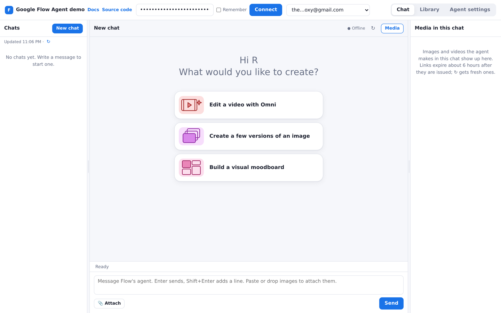
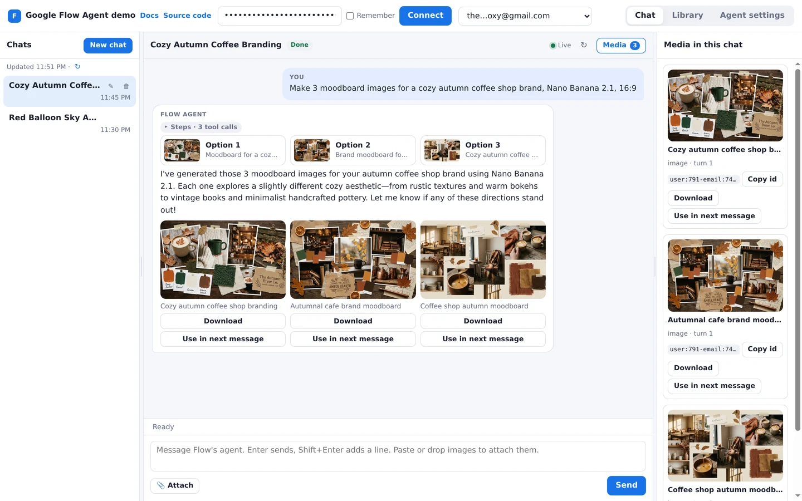
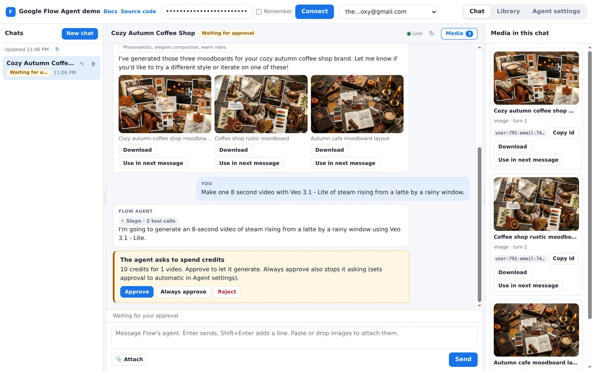
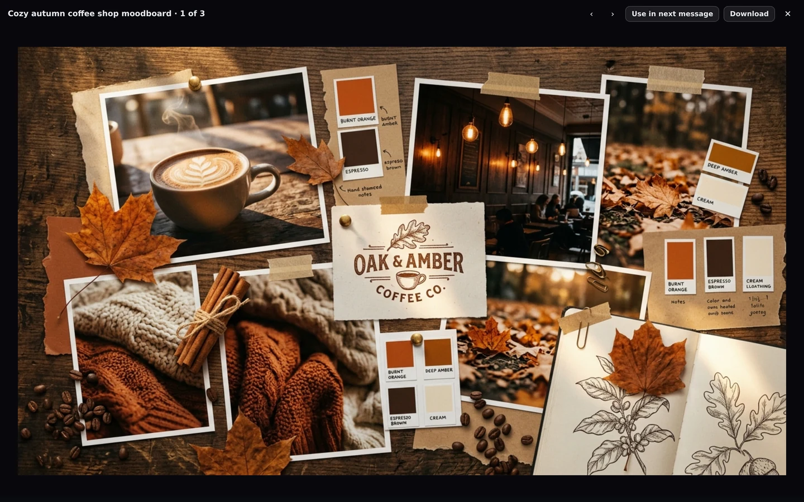
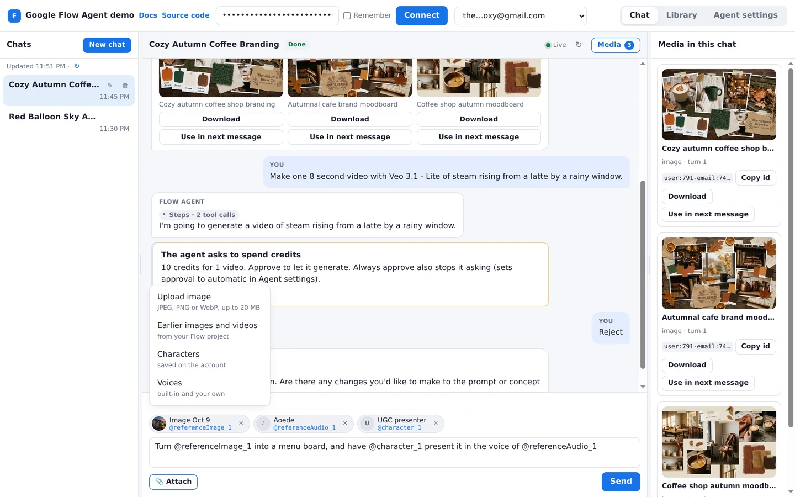
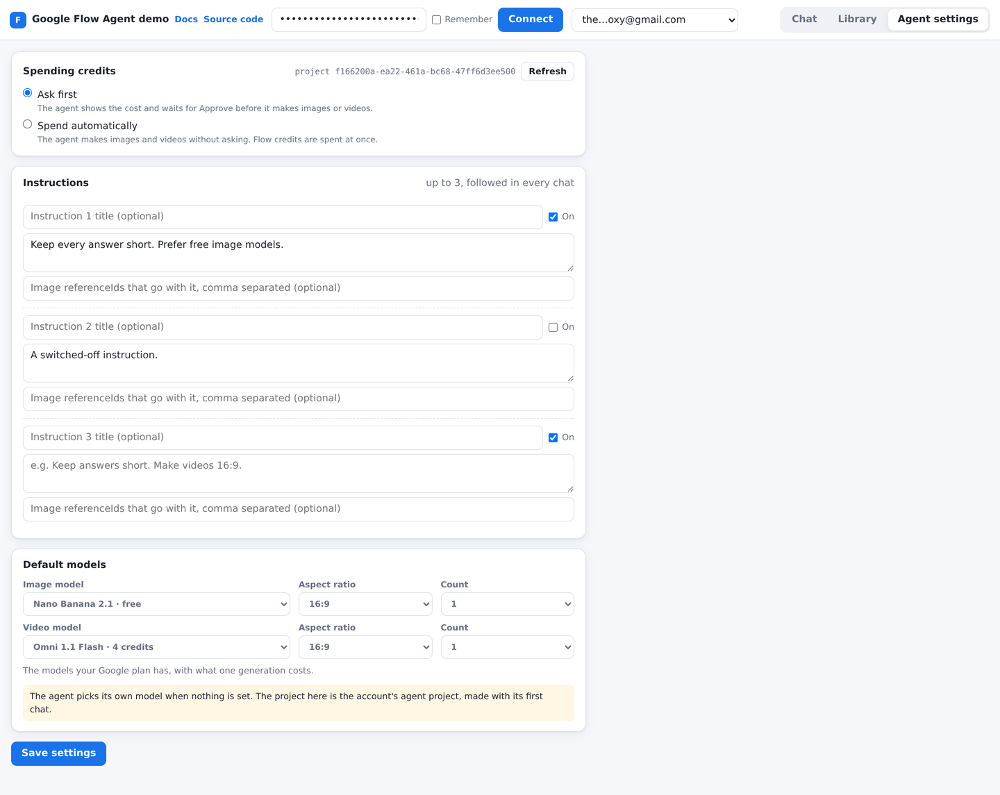
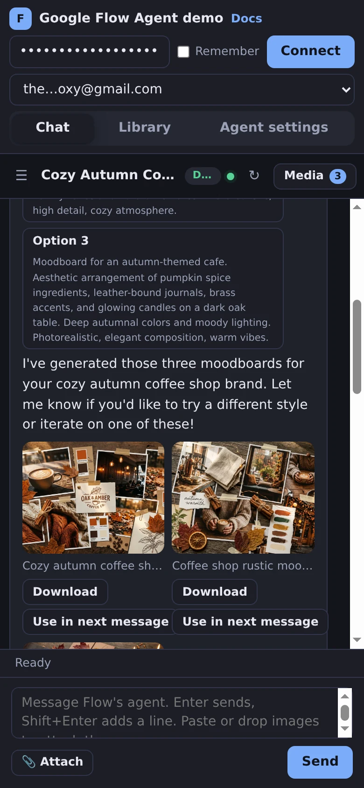
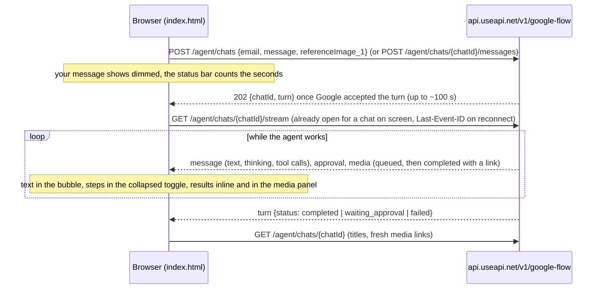
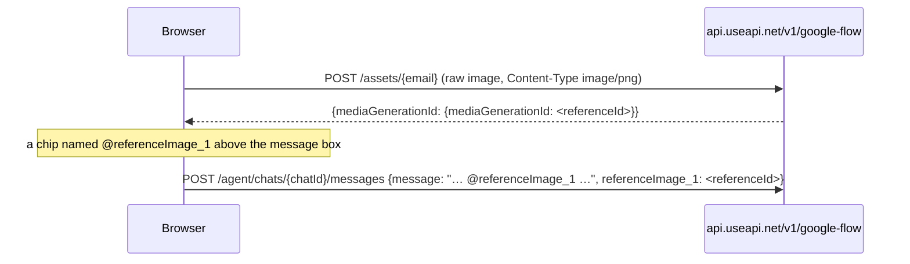
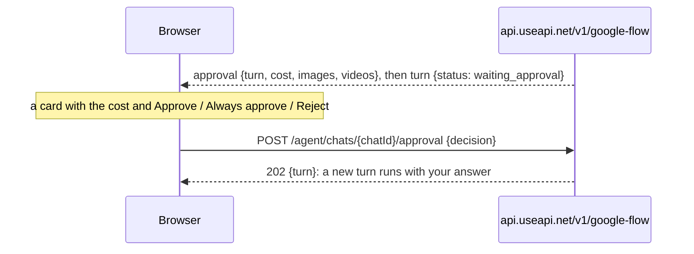

# Google Flow agent chat in the browser — Google Flow Agent API demo app

▶️ Live: **[useapi.net/demos/google-flow](https://useapi.net/demos/google-flow/?utm_source=github.com&utm_medium=referral&utm_campaign=google-flow-api)** — these exact files, full screen, also on phones · [what each feature calls](https://useapi.net/docs/api-google-flow-v1/agent-demo?utm_source=github.com&utm_medium=referral&utm_campaign=google-flow-api)

A complete chat client for **Google Flow's creative agent**, built on the [Google Flow Agent API](https://useapi.net/docs/api-google-flow-v1/agent?utm_source=github.com&utm_medium=referral&utm_campaign=google-flow-api) by [useapi.net](https://useapi.net/?utm_source=github.com&utm_medium=referral&utm_campaign=google-flow-api). You start a chat, keep talking to the agent, and the images and videos it makes appear right in the conversation. It is plain HTML, CSS and JavaScript in five small files: no framework, no build step, no dependencies. Read them top to bottom to see how each feature maps to one API call.

- **New chat**: like Flow's own agent panel, a new chat greets you by your Google first name, asks "What would you like to create?" and offers 3 starter cards picked at random from Flow's 14 (Brainstorm with me, Develop a storyboard, Edit a video with Omni and more). A card sends its label as your first message.
- **Chat**: your chats on the left, the conversation in the middle, the chat's images and videos on the right (drag the dividers to resize, and on a phone both side panels open as drawers). The agent's answer arrives live, its thinking and tool calls sit in a collapsed **Steps** toggle, and the options it offers become buttons that send your choice.
- **Results**: every image and video the agent makes shows inline, with its status while a video is queued. Click one to open it full size (zoom an image, play a video, step through the chat's results with the arrow keys). **Download** saves it, **Use in next message** attaches it to what you write next.
- **Attach along the way**: the **Attach** menu uploads images from disk, or picks earlier images and videos, characters and voices (built-in or your own) from the account. You can also drop images on the conversation or paste them. Each attachment shows as a chip above the message box with its `@referenceImage_1` style name: click it to put the mention in your text, or just send.
- **Spending credits**: when the agent asks before generating, a card shows the cost and the number of images and videos, with **Approve**, **Always approve** and **Reject**.
- **Library**: the account's images and videos, project by project (the main project, or the agent's own), with previews, upload, download, copy id and delete.
- **Agent settings**: whether the agent asks before spending credits, up to 3 instructions it follows in every chat, and the default image and video models, picked from the models your Google plan has with what one generation costs (for example "Veo 3.1 - Fast · 20 credits", "Nano Banana Pro · free").

## Screenshots

Taken on the live demo with a real account: three Nano Banana 2.1 images, and a Veo 3.1 Lite request that was rejected at the cost card.



*1. A new chat greets you and offers three starter cards.*



*2. The agent's images appear inline, with Download and Use in next message. Its tool calls sit in the collapsed Steps toggle.*



*3. Before spending credits the agent asks, and the card shows the cost.*



*4. Click a result to see it full size.*



*5. Attach uploads, earlier images and videos, characters and voices, each with its @-mention.*



*6. Agent settings: approval, instructions, and the plan's models with what one generation costs.*



*7. On a phone, in the dark theme.*

## Run it

You need a useapi.net [API token](https://useapi.net/docs/start-here/setup-useapi?utm_source=github.com&utm_medium=referral&utm_campaign=google-flow-api) and a Google account added with the [Google Flow setup](https://useapi.net/docs/start-here/setup-google-flow?utm_source=github.com&utm_medium=referral&utm_campaign=google-flow-api).

Open `index.html` in a browser (double-click it), or serve the folder:

```bash
git clone https://github.com/useapi/google-flow-api.git
cd google-flow-api
npx serve demo
```

Paste the API token, press **Connect**, pick the account, and write a message.

The page calls the production API (`/v1/google-flow`). Add `?api=dev` to the address to use the development API (`/v1-dev/google-flow`, a **DEV API** badge shows), and `?api=prod` to go back. The choice is remembered until the tab closes.

Your token stays in the browser and is sent only to `api.useapi.net`. It is kept in the page's memory, and in `sessionStorage` (until the tab closes) only when you tick **Remember**.

## Keyboard

- Enter sends, Shift+Enter adds a new line. Paste an image (Ctrl+V or Cmd+V) to attach it.
- Left and Right arrows move between the Chat, Library and Agent settings tabs (and the tabs of the Attach picker), and resize the columns when a divider has focus (hold Shift for bigger steps).
- In the full-size view, Left and Right arrows step through the chat's images and videos, and Escape closes it.
- Up and Down arrows move through the Attach menu. Escape closes it, cancels an in-page confirmation or rename, and on a phone closes the chat list or media drawer.

## API calls by feature

Base URL `https://api.useapi.net/v1/google-flow`, header `Authorization: Bearer <API token>`.

| Feature | API call |
|---|---|
| Account picker | [GET /accounts](https://useapi.net/docs/api-google-flow-v1/get-google-flow-accounts?utm_source=github.com&utm_medium=referral&utm_campaign=google-flow-api) |
| Greeting on a new chat ("Hi <first name>") | [GET /accounts/{email}](https://useapi.net/docs/api-google-flow-v1/get-google-flow-accounts-email?utm_source=github.com&utm_medium=referral&utm_campaign=google-flow-api) (`sessionData.user.name`, read once per account) |
| Chat list | [GET /agent/chats](https://useapi.net/docs/api-google-flow-v1/get-google-flow-agent-chats?utm_source=github.com&utm_medium=referral&utm_campaign=google-flow-api) `?email=` |
| Send the first message of a new chat | [POST /agent/chats](https://useapi.net/docs/api-google-flow-v1/post-google-flow-agent-chats?utm_source=github.com&utm_medium=referral&utm_campaign=google-flow-api) `{email, message, referenceImage_1…}` |
| Send a message, choice buttons | [POST /agent/chats/{chatId}/messages](https://useapi.net/docs/api-google-flow-v1/post-google-flow-agent-chats-chatId-messages?utm_source=github.com&utm_medium=referral&utm_campaign=google-flow-api) `{message, referenceImage_1…}` |
| The conversation, live | [GET /agent/chats/{chatId}/stream](https://useapi.net/docs/api-google-flow-v1/get-google-flow-agent-chats-chatId-stream?utm_source=github.com&utm_medium=referral&utm_campaign=google-flow-api) with `Last-Event-ID` |
| Opening a chat, ↻ (fresh media links), after each turn | [GET /agent/chats/{chatId}](https://useapi.net/docs/api-google-flow-v1/get-google-flow-agent-chats-chatId?utm_source=github.com&utm_medium=referral&utm_campaign=google-flow-api) |
| Rename a chat | [PATCH /agent/chats/{chatId}](https://useapi.net/docs/api-google-flow-v1/patch-google-flow-agent-chats-chatId?utm_source=github.com&utm_medium=referral&utm_campaign=google-flow-api) `{title}` |
| Delete a chat | [DELETE /agent/chats/{chatId}](https://useapi.net/docs/api-google-flow-v1/delete-google-flow-agent-chats-chatId?utm_source=github.com&utm_medium=referral&utm_campaign=google-flow-api) |
| Approval card buttons | [POST /agent/chats/{chatId}/approval](https://useapi.net/docs/api-google-flow-v1/post-google-flow-agent-chats-chatId-approval?utm_source=github.com&utm_medium=referral&utm_campaign=google-flow-api) `{decision}` (`approve`, `always`, `reject`) |
| Attach: upload, drop or paste an image, Library: Upload image | [POST /assets/{email}](https://useapi.net/docs/api-google-flow-v1/post-google-flow-assets-email?utm_source=github.com&utm_medium=referral&utm_campaign=google-flow-api) with the raw image as the body (JPEG, PNG or WebP, up to 20 MB) |
| Attach: earlier images and videos, Library | [GET /assets/media/{email}](https://useapi.net/docs/api-google-flow-v1/get-google-flow-assets-media-email?utm_source=github.com&utm_medium=referral&utm_campaign=google-flow-api) `?projectId=` |
| Previews in the picker and Library, a renewed link | [GET /assets/{referenceId}](https://useapi.net/docs/api-google-flow-v1/get-google-flow-assets-mediagenerationid?utm_source=github.com&utm_medium=referral&utm_campaign=google-flow-api) |
| Library: Delete | [DELETE /assets/{email}](https://useapi.net/docs/api-google-flow-v1/delete-google-flow-assets-email?utm_source=github.com&utm_medium=referral&utm_campaign=google-flow-api) `{mediaGenerationIds, projectId}` |
| Attach: characters | [GET /characters](https://useapi.net/docs/api-google-flow-v1/get-google-flow-characters?utm_source=github.com&utm_medium=referral&utm_campaign=google-flow-api) `?email=` |
| Attach: voices | [GET /voices](https://useapi.net/docs/api-google-flow-v1/get-google-flow-voices?utm_source=github.com&utm_medium=referral&utm_campaign=google-flow-api) `?email=` |
| Agent settings, and the default-model lists (`models`: the plan's image and video models with their credits) | [GET /agent/settings](https://useapi.net/docs/api-google-flow-v1/get-google-flow-agent-settings?utm_source=github.com&utm_medium=referral&utm_campaign=google-flow-api) `?email=` |
| Save settings | [PUT /agent/settings](https://useapi.net/docs/api-google-flow-v1/put-google-flow-agent-settings?utm_source=github.com&utm_medium=referral&utm_campaign=google-flow-api) `{email, approval, instructions, imageDefaults, videoDefaults}` (only what changed) |
| Download | the image's or video's signed link, read as a file (no token needed) |

## How it works

| File | What it holds |
|---|---|
| `index.html` | the whole UI: top bar (token, account, tabs), the Chat tab's three columns, Library, Agent settings, the Attach picker and the full-size view |
| `api.js` | every API call (one function each), the `?api=dev` switch, uploads and downloads |
| `sse.js` | the chat stream: Server-Sent Events read with `fetch()`, resume with `Last-Event-ID`, reconnects |
| `render.js` | DOM building: Markdown, the agent's steps, previews, result figures, media cards |
| `app.js` | the app, in numbered sections: connect, chat list, one chat, the stream, sending, attachments, full-size view, Library, settings, layout |
| `styles.css` | light and dark theme from one set of tokens, the layout, and phone drawers |

The [Agent overview](https://useapi.net/docs/api-google-flow-v1/agent?utm_source=github.com&utm_medium=referral&utm_campaign=google-flow-api) covers the API itself in full.

### Sending a message and receiving the answer



- A send answers `202` only once Google has accepted the turn, which can take up to about 100 seconds (a captcha is solved for every turn). The page allows 150 seconds and shows the wait in the status bar.
- The stream is read with `fetch()`, not `EventSource`, because `EventSource` cannot send the `Authorization` header.
- Stream ids are per turn: `<turn>:<messageId>`, `<turn>:approval`, `<turn>:end` and `<turn>:m:<mediaId>`. Opening a chat draws its finished turns from `GET /agent/chats/{chatId}` and starts the stream with `Last-Event-ID: <last finished turn>:end`, so the stream carries only what is new. A reconnect sends the last id it received and resumes right after it. Media ids are not used to resume, because the API replays the whole turn for them.
- The API closes a stream after 10 quiet minutes (`idle`). The page opens it again when you send, press ↻ or come back to the tab.
- Text from the API is always set with `textContent`. The agent's Markdown is turned into DOM nodes by a small renderer, never parsed as HTML.

### Attachments and references



- Each attachment takes the next free slot of its kind: `referenceImage_1` to `_7`, `referenceVideo_1`, `referenceAudio_1` to `_5` (a built-in voice name or your own voice) and `character_1` to `_7`, the same parameters as `POST /videos`. Removing a chip frees its slot without renumbering the others, so mentions you already typed stay right.
- A mentioned reference becomes a chip in the agent's view of your message. An unmentioned one is still attached.
- References must come from the chat's account. The page uploads to the selected account and lists only that account's media, characters and voices.

### Approvals



## Good to know

- Media links are Google's signed links and expire about 6 hours after they are issued. A preview that stops loading, or a Download from an old link, asks `GET /assets/{referenceId}` for a fresh one. ↻ reads the whole chat again.
- A `referenceId` works in the next message, and also in [POST /images](https://useapi.net/docs/api-google-flow-v1/post-google-flow-images?utm_source=github.com&utm_medium=referral&utm_campaign=google-flow-api) and [POST /videos](https://useapi.net/docs/api-google-flow-v1/post-google-flow-videos?utm_source=github.com&utm_medium=referral&utm_campaign=google-flow-api).
- One turn runs at a time per chat (a send meanwhile answers `409`), and up to 3 per account (a fourth answers `429` with `retryAfter`).
- A `504` on a send means Google has not confirmed the turn yet, but it may still start. The page reads the chat again instead of sending twice.
- **Always approve** also sets the account's approval mode to automatic: after that the agent spends Flow credits without asking. Switch it back in Agent settings.
- Deleting a chat removes its history. The images and videos it made stay on the account (Library).
- What the agent makes lives in the account's agent project. The Library's project picker shows it next to the main project.

## About useapi.net

[useapi.net](https://useapi.net/?utm_source=github.com&utm_medium=referral&utm_campaign=google-flow-api) is an experimental REST API for AI services. The Google Flow API drives your own Google Flow / Google AI subscription for a flat [$15/month](https://useapi.net/docs/subscription?utm_source=github.com&utm_medium=referral&utm_campaign=google-flow-api), so the agent spends your plan's Flow credits at consumer rates. It is an independent, third-party API, not affiliated with or endorsed by Google.

Visit our [Discord Server](https://discord.gg/w28uK3cnmF) or [Telegram Channel](https://t.me/use_api) for support.
